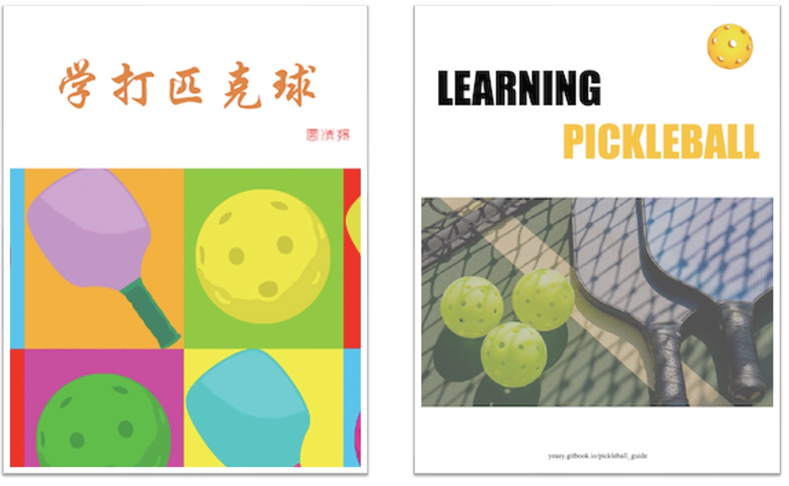

# 学打匹克球 | Learning Pickleball

匹克球规则、技术与战术。 Rules, skills, and tactics.

**[中文第一章](https://yeasy.gitbook.io/learning_pickleball/01_background)** · **[Chapter 1 in English](https://yeasy.gitbook.io/learning_pickleball/learning_pickleball_en/01_background)**（GitBook）

[中文导读](cn/README.md) · [English introduction](en/README.md) · [全书目录 / Contents](https://github.com/yeasy/learning_pickleball/blob/main/SUMMARY.md) · [正式 PDF / PDF editions](https://github.com/yeasy/learning_pickleball/releases/latest)

## 关于本书

> **匹克球** 是一项融合网球、羽毛球和乒乓球特点的新兴运动——上手容易、运动量适中、趣味性强。本书结合北美教学实践，系统讲解从入门到进阶的完整技术体系。

## 从哪里开始 / Where to start

- **第一次上场 / Before your first game** · [基本规则](https://yeasy.gitbook.io/learning_pickleball/01_background#id-1.3-ji-ben-gui-ze) / [Basic rules](https://yeasy.gitbook.io/learning_pickleball/learning_pickleball_en/01_background#id-1.3-basic-rules)
- **开始练球 / First practice** · [发球与接发球](https://yeasy.gitbook.io/learning_pickleball/05_serve) / [Serve and return](https://yeasy.gitbook.io/learning_pickleball/learning_pickleball_en/05_serve)
- **学习比赛战术 / Match tactics** · [双打策略](https://yeasy.gitbook.io/learning_pickleball/18_double_strategy) / [Doubles strategy](https://yeasy.gitbook.io/learning_pickleball/learning_pickleball_en/18_double_strategy)

其他阅读入口 / More reading options

- GitBook · [中文版首页](https://yeasy.gitbook.io/learning_pickleball) / [English edition home](https://yeasy.gitbook.io/learning_pickleball/learning_pickleball_en)
- 中匹在线 · [中文版](https://pickleballcn.com/books/learning-pickleball/)

## 授权与版权 / License and authorization

本书已授权 [全球多家俱乐部和学校](https://github.com/yeasy/learning_pickleball/wiki/) 用于公益培训，**未经授权禁止用于商业用途**。

[许可证 / License](https://github.com/yeasy/learning_pickleball/blob/main/LICENSE)
