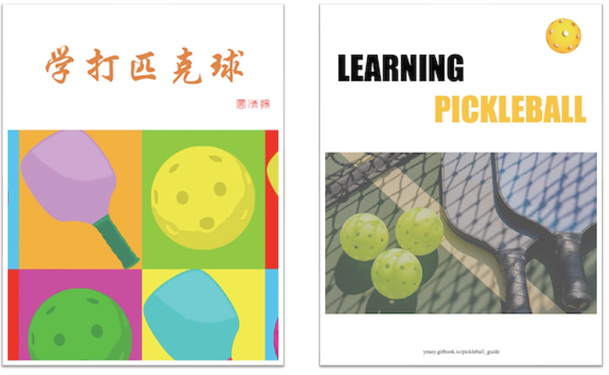
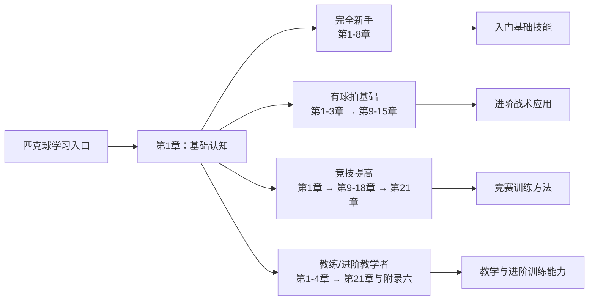

# 学打匹克球

从基本规则和击球练习入门，逐步学习单打与双打策略。

**[在 GitBook 阅读第 1 章 · 背景知识](https://yeasy.gitbook.io/learning_pickleball/01_background)**

[中文版目录（GitHub）](https://github.com/yeasy/learning_pickleball/blob/main/cn/SUMMARY.md) · [正式 PDF（发布页）](https://github.com/yeasy/learning_pickleball/releases/latest) · [English edition](https://yeasy.gitbook.io/learning_pickleball/learning_pickleball_en)

## 简介

**匹克球** 是一项风靡全球的新兴运动，融合了网球、羽毛球和乒乓球的特点。它上手容易、运动量适中且趣味性强。本书结合北美教学实践，系统讲解匹克球技术，帮助读者科学训练，降低伤痛风险，享受运动乐趣。

## 从哪里开始

- **第一次上场** · 阅读[基本规则](https://yeasy.gitbook.io/learning_pickleball/01_background#id-1.3-ji-ben-gui-ze)，了解计分、两次落地规则和非截击区。
- **准备第一次练球** · 先读[热身](https://yeasy.gitbook.io/learning_pickleball/04_fitness)与[持拍](https://yeasy.gitbook.io/learning_pickleball/03_hold_paddle)，再和球友练习[发球与接发球](https://yeasy.gitbook.io/learning_pickleball/05_serve)和[前场吊球](https://yeasy.gitbook.io/learning_pickleball/06_dink)。
- **已经能打回合** · 读[双打策略](https://yeasy.gitbook.io/learning_pickleball/18_double_strategy)，练习与搭档从后场一起推进到网前。打单打时，参照[单打策略](https://yeasy.gitbook.io/learning_pickleball/17_single_strategy)练习发球落点和回位。

需要安排每周练习时，可在[第 2 章 · 学习路径](https://yeasy.gitbook.io/learning_pickleball/02_learning_pathways)完成自评，再选择相应的训练计划。

## 学习路线图

速查资料与其他阅读入口

- [要点总结](https://yeasy.gitbook.io/learning_pickleball/19_key_tips) · [常见问题](https://yeasy.gitbook.io/learning_pickleball/20_faq) · [匹克球术语](https://yeasy.gitbook.io/learning_pickleball/appendix_terminologies)
- [中匹在线中文版](https://pickleballcn.com/books/learning-pickleball/)

## 授权与版权

本书已授权 [全球多家俱乐部和学校](https://github.com/yeasy/learning_pickleball/wiki/) 用于公益培训。
**未经授权，禁止用于商业用途。**

[许可证](https://github.com/yeasy/learning_pickleball/blob/main/LICENSE)
