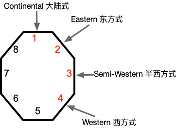
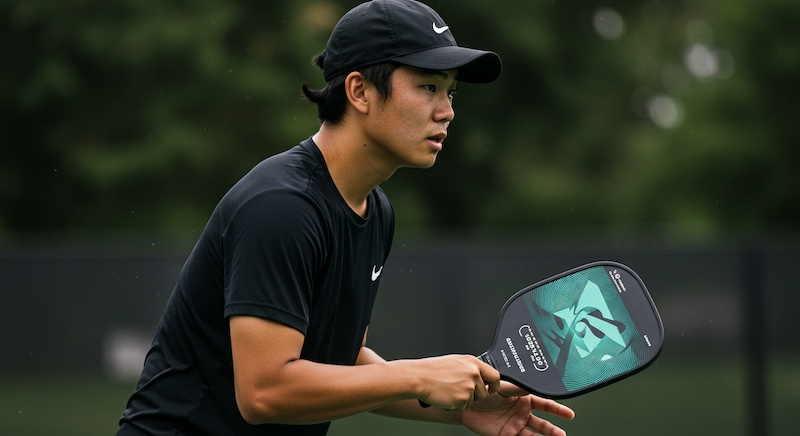

# Chapter 3 Hold Paddle and Hit the Ball

> **Recommended Level**: 2.0+ · Your very first lesson — build correct grip and power habits from scratch

Holding the paddle to hit the ball with power correctly is the most fundamental skill of learning to play pickleball. Players should be able to hit the ball with different power, speed, placement and spin in the correct way.

Using a wrong way of holding paddle or generating force will restrict the improvement of the player's level and easily bring injuries.

## 3.1 Hold Paddle

The paddle handle has eight flat sides, called bevels. In the diagram, find the V between your thumb and index finger and note which numbered bevel it points toward. The four grips shown are **continental** (neutral), **eastern**, **semi-western**, and **western**.

The characteristics of the various styles are summarized as follows:

* **Continental Style**: The V points toward bevel 1, which is similar to a handshake or hammer-holding position. When holding with the right hand, the paddle's forehand surface will face to the left after straightening the arm. Continental style makes it easy to hit the ball with either forehand or backhand, and switch quickly between them. But it is not conducive to creating strong friction. This style can be adopted in most situations in the game.
* **Eastern Style**: The V points toward bevel 2. When holding with the right hand, the paddle's forehand surface will face slightly to the lower left after straightening the arm. Compared with the continental grip, the eastern style can generate more topspin movements by the forehand, which can be used in the drive or drop by forehand.
* **Semi-Western Style**: The V points toward bevel 3. When holding with the right hand, the paddle's forehand surface will face to the lower left after straightening the arm. The semi-western grip can produce more topspin with larger hitting range by the forehand than the eastern grip, but it is difficult to hit the ball from backhand or generate backspin. This style can be used in the drive from backcourt or volley in the front-court by the forehand.
* **Western Style**: The V points toward bevel 4, the so-called lucky cat grip. When holding with the right hand, the paddle's forehand surface will face towards the ground after straightening the arm. The Western grip is an extreme grip that gives up the backhand, and is rarely used in pickleball games except occasional usage in smash in the front-court by forehand.

Generally, the continental grip and eastern grip are recommended as the base grips, and fine-tuning can be made according to the specific situation.

> **Two-Handed Backhand Trend**: In recent years, an increasing number of professional players have adopted the two-handed backhand in pickleball (similar to the two-handed backhand in tennis). It provides greater stability and power, especially for backhand drives and lobs. However, it sacrifices some reach and net flexibility. Players with a tennis or badminton two-handed backhand background can continue using it in pickleball. Beginners are recommended to master single-handed backhand fundamentals first, then decide whether to develop a two-handed backhand based on personal preference.

After hitting the ball, players should immediately return to their ready position, keeping the paddle in front of them. Hold the paddle with your paddle hand, and the fingers of your non-racquet hand should lightly touch the surface of the paddle.

When holding the paddle, your palm should be relaxed, with the palm of your hand empty. A 3 out of 10 is sufficient for the ready position. The player should maintain a relaxed yet steady position, and a steady yet restrained grip. At the moment of hitting the ball, apply a firm grip to maintain a stable paddle face.

For a forehand drive or dink, try an eastern grip with your fingers around the handle. Some players rest the index finger on the paddle face for a backhand dink to feel its angle. Keep the finger on the handle during basic drills so you can switch shots freely.

When using the backhand, you can use a continental grip and place your thumb on bevel 7 (the upper wide side of the handle) to assist with power and keep the paddle stable.

## 3.2 Hit the Ball

Players should keep their body facing the incoming ball at all times, and place the paddle in front of their chest (the head of the paddle can be pointed straight up ahead or slightly to the backhand), be ready to hit the ball.

A pickleball's perforated surface produces less spin than a tennis or table tennis ball, but you can still generate effective spin through paddle-face angle and friction. Consistent contact position and paddle-face control are therefore essential.

First, hit the ball with the sweet spot of the paddle, which guarantees the ball's flight direction is the same with paddle surface, and the power will be transferred to the ball efficiently. Hitting the ball from the non-sweet spot will cause the reduction of power and the instability of the ball; secondly, the paddle should be held tightly when the ball is hit, to make sure that the power is stably transmitted to the ball. In addition, after hitting the ball, your arm should continue to follow through in the direction of the ball's flying to ensure that the ball can be sent stably.

In order to learn how to hit the ball accurately, always pay attention to the incoming ball and track the ball with your eyes. Once mastered, you can focus partly on the opposing player's position, and partly on hitting the ball. At the same time, you can anticipate the opponent's possible return and moves.

From practices, the players should be able to feel and understand how to use appropriate power, speed, placement and spin when hitting the ball.

## 3.3 Use Power

The source of power in pickleball comes from the legs rather than the arms, which may seem surprising. However, if you have ever tried playing on an ice rink, you would realize how difficult it is to generate power.

Take a forehand stroke as an example, assuming a right-handed grip. When preparing to hit the ball, the body turns to the right, with the weight centered on the right foot. The right leg pushes off the ground forcefully, the hips move forward, and the waist rotates accordingly, driving the arm through the swing. At this moment, the power generated by pushing off the ground and rotating the waist is transmitted through the arm to the paddle. Upon contact with the ball, the forearm tightens, and the fingers grip the paddle firmly, further enhancing the striking force and stabilizing the paddle's direction. Ultimately, the power generated by the entire body is transferred to the ball, sending it forward. During this process, the body moves forward, shifting the weight from the right foot to the left foot.

In terms of sequence, you need to engage the feet, legs, waist, torso, shoulders, upper arm, forearm, and hand in turn, progressively adding force and ultimately transmitting the combined power to the paddle.

It is important to keep all parts of the body (especially the arms and fingers) relaxed before hitting the ball, tightening explosively at the moment of impact, and then naturally relaxing again after the hit. By transitioning from relaxation to tension, you can generate significant power with minimal movement.

In situations such as dink or volley, you do not need to use the motions from legs or body, but the principle is the same. You still need to generate the power by tightening your fingers, and the power comes from the body.

## 3.4 Common Errors and Corrections

* **Grip too tight**: Tension in the hand and forearm reduces control. Relax during preparation and firm the grip only enough to stabilize the face at contact.
* **Unstable paddle face**: An excessively closed face sends the ball low; an excessively open face sends it high. Track the bounce and adjust with small changes rather than a fixed angle for every shot.
* **Arm-only power**: Use the legs and trunk to support the stroke instead of forcing the ball with the arm.
* **Poor contact height**: Move the feet so contact occurs in a comfortable zone in front of the body.
* **No natural follow-through**: Let the paddle continue smoothly toward the intended path instead of stopping abruptly at contact.

## 3.5 Daily Trainings

Here is a tiered progression of drills for building hitting ability:

### Beginner

* Leg-drive and waist-rotation drill: 20 reps × 3 sets
* Paddle ball-bouncing (forehand, backhand, alternating): 50 reps × 3 sets
* Soft wall rallies: 1 minute × 2 sets

### Intermediate

* Leg-drive, waist-rotation, and full swing: 30 reps × 5 sets
* Paddle ball-bouncing with rhythm changes: 100 reps × 3 sets
* Forehand/backhand multi-ball hitting: 30 reps × 5 sets

### Advanced

* Explosive leg-drive and waist-rotation swings: 50 reps × 10 sets
* Paddle ball-bouncing (varied pace and contact points): 150 reps × 4 sets
* Multi-ball hitting with footwork movement: 50 reps × 10 sets

Consistent long-term training produces steady improvement. Take adequate rest to avoid overuse fatigue or injury.

## 3.6 Footwork Awareness: Get in Position Before You Hit

Before diving into the various stroke techniques in the following chapters, there is one core principle to internalize: **move into position first, then execute the stroke**.

Every stroke technique — whether serving, dinking, or volleying — relies on your body being in the right position. No matter how perfect your hand technique is, you cannot hit a quality shot if your feet are not set. The most common mistake among beginners is "standing still and swinging": waiting for the ball to come to you rather than actively moving to the optimal hitting position.

As you practice each technique in the subsequent chapters, always keep this awareness in mind:

* **Before the shot**: Use small adjustment steps to position yourself so your body faces the incoming ball.
* **During the shot**: Stay balanced with knees slightly bent, and execute the stroke within your comfortable hitting zone.
* **After the shot**: Immediately recover to a sensible court position to prepare for the next shot.

A comprehensive guide to footwork is provided in [Chapter 12](12_footwork.md), but start building this "position first, hit second" mindset right now.
