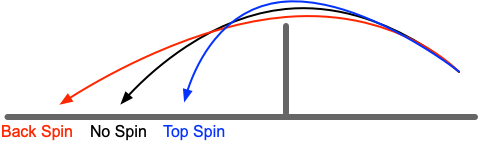
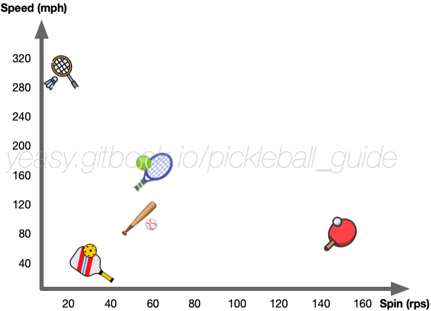

# Chapter 13 Master Spin

> **Recommended Level**: 3.5+ · Intermediate-advanced skill for adding variation and deception

Spin is an important charm of ball games. Reasonable adoption of spin can allow to control the ball’s flight path and landing position in a better way.

## 13.1 Spin types

Different spins can cause different offset of the ball’s flight path. According to the direction of Spin, it can be divided into the following categories:

* **Topspin**: The ball rolls forward rapidly, causing the trajectory to fall sharply. The ball path is shorter than that of non-spinning balls, and will move forward quickly after bounce up;
* **Backspin**: The ball rolls back quickly, resulting in a flatter trajectory and a longer ball path than a non-spinning ball. The ball will move forward slowly after bounce, even move backward;
* **Sidespin**: Including left-spin or right-spin, the ball will deviate in the direction of Spin.

## 13.2 When to Use Spin

Consider using Spin in the following scenarios:

* Serve: Use spins to cause the opponent's prediction error on the ball's trajectory;
* Dink or Drop: Use spins to cause the opponent to hit the ball at an uncomfortable position, forcing the return ball too high or too low;
* Drive or lob: Use topspin to avoid letting the ball go out;
* Volley: Use spins to cause the opponent to fail to return the ball;
* ATP: Use side spin to let the ball land into the court from outside.

Pay attention that when adding spin to the ball, because part of the energy turns into the rotation instead of flight speed, the ball usually flies slower than normal. And it will take longer time to swing the paddle. Therefore, when you want to let the ball fly very fast or return quickly, try to use as little spin as possible.

## 13.3 Understand Spin

### How Spin Is Generated

Spin on a pickleball is not generated simply by brushing the ball across the paddle surface, but by striking different parts of the ball while rotating the paddle face to wrap around it. Prioritize a solid hit first, then wrap and push through the ball—remember to **"hit first, brush second"**.

* **Generating topspin**: Contact the lower-middle part of the ball (just below the equator) and brush upward so the ball rolls forward rapidly.
* **Generating backspin**: Contact the upper-middle part of the ball (just above the equator) and brush downward so the ball spins backward rapidly.
* **Generating sidespin**: Contact the side of the ball (left or right) and brush toward that side so the ball curves in the spin direction.

In general, **a paddle with a textured surface increases friction against the ball**, helping generate more spin. See [Appendix VI: Equipment Selection Guide](appendix_equipment.md) for details on raw carbon paddle surfaces.

### Spin Data and Impact

The spin of the pickleball typically ranges from 15 to 30 revolutions per second in practical play. Tennis and table tennis can generate substantially higher spin, but exact numbers vary by shot type, equipment, and measurement method. With the popularity of Raw Carbon surface paddles, professional players using textured paddles can generate stronger spins, with some top players' topspin balls exceeding 30 rps. The flight of the ball is relatively slow. Spin has limited effect on the ball's flight path compared with its effect after the bounce: topspin can kick forward, backspin can skid or slow, and sidespin can shift laterally. The graph below compares spin and flight-speed ranges for popular ball games.

## 13.4 Handle Spinning Balls

To handle a spinning ball well, first understand how each spin type affects the ball's flight path and behavior after the bounce, then move proactively into position for a solid hit.

### Strategies by Spin Type

**Handling topspin**:

* Topspin drops sharply and bounces shorter than expected—step forward early to get into position.
* Close the paddle face slightly (tilt downward 5–10°) to counter the forward kick off the bounce.
* Use the opponent's topspin pace with a controlled, compact contact rather than a big swing.

**Handling backspin**:

* Backspin stays flatter and travels deeper than expected—take a step back to give yourself room.
* Open the paddle face (tilt upward 10–15°) and lift through the ball to keep it from diving into the net.
* Brush upward more fully than on a flat ball, taking advantage of the lifting motion of the paddle face.

**Handling sidespin**:

* Sidespin curves in the direction of the spin—adjust your stance into the curve, shifting slightly toward the side opposite the ball's lateral break.
* For example, against a ball curving to your right, move forward and left, and angle the paddle face slightly right to offset the deflection.

### General Principles

The simplest rule is to **match the spin creator's stroke in reverse**: strike the same part of the ball in the opposite direction to neutralize the spin. Alternatively, **increase your swing speed** to shorten ball-to-paddle contact time and reduce the spin's effect.

## 13.5 Common Errors and Corrections

| Error | Cause | Correction |
|---|---|---|
| Topspin return goes into the net | Paddle face and spacing are not matched to the bounce | Prepare earlier, adjust spacing, and test a slightly different face angle |
| Backspin return floats long | Face is too open or contact is too high | Reduce lift and contact in a stable zone in front |
| Sidespin pulls the return away | Spin direction was read late | Read the bounce and move to create room before contact |
| Placement varies against spin | Swing pace changes with every ball | Slow the drill and build a repeatable tempo before adding speed |

## 13.6 Training Methods

You can build spin control and spin recognition with the following progressive drills, paying attention to how softly contacting different spots on the ball changes the spin:

**Beginner (Fundamentals)**:

* Paddle ball-bouncing with spin: gently slice upward, downward, left, and right to feel each spin direction;
* Single-spot bounce observation: bounce 20 consecutive topspin taps and watch the ball kick forward; then try 20 backspin taps and watch the ball pull back.

**Intermediate (Practical Application)**:

* Spin serves: contact different zones (lower-middle, upper-middle, side) to serve different spins and observe the post-bounce trajectory;
* Spin dinks: vary contact points during dinking drills to feel how each contact alters spin and arc.

**Advanced (Match Drills)**:

* Multi-ball response drill: a partner feeds specific spins (5 each of topspin, backspin, and sidespin) while you return to a target zone (such as the deep baseline) and track your success rate;
* Match scenarios: read spin off opponent shots from both the kitchen and baseline, adjusting paddle-face angle and footwork immediately.
