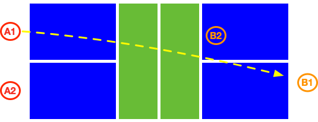
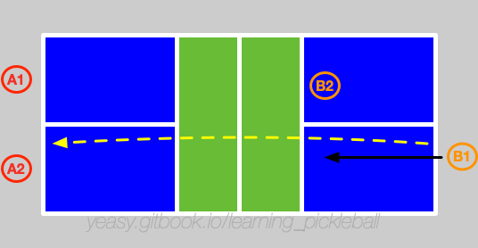
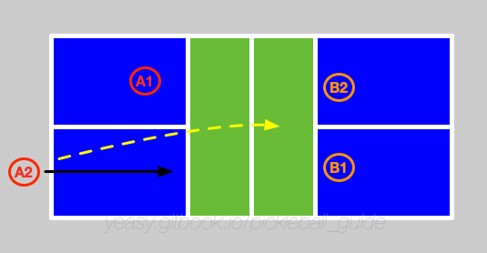
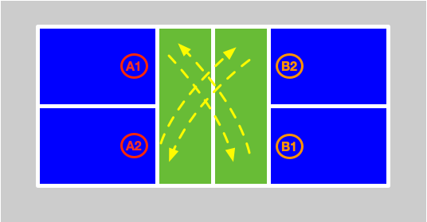

# Chapter 18 Doubles Game Strategies

> **Recommended Level**: 5.5+ · The decisive differentiator at advanced levels — systematic study of teamwork and tactics

Doubles is the most common game format in pickleball, and its key is efficient collaboration between both partners.

> **Related technique chapters**: [Dink](06_dink.md), [Drop](07_drop.md), [Drive](08_drive.md), [Volley](09_volley.md), [Net Battle](14_net_battle.md), [ATP](15_atp.md), [Erne](16_erne.md)

## 18.1 Basic Process

The main process of doubles is divided into two stages: a) **Move from the backcourt to the NVZ**, and b) **Battle near the net**.

Suppose the two teams are A and B, respectively, including two players A1, A2, B1, B2.

A1 is serving, and B2 is standing in front of the net, as shown in the figure.

A1 serves the ball to the diagonal opponent B1. B1 tries to return the ball to the baseline of team A, and at the same time, B1 follows the ball to run to the net.

At this moment, two players of team B are in front of the net to try attacking, and two players of team A are in the backcourt.

Assuming A2 will hit the third shot, A1 takes a step forward and prepares to go to the net, while observing the third shot. A2 hits the third shot by dropping the ball, and A2 follows the ball to go to the net at the same time. Now the phase of going to the net ends.

Now, the players of team A and B are both in front of the net, and the game enters the most critical **net-rally phase**.

Usually players use the Dink technique to mobilize the opponents, and try to create attack opportunities. Because only the serving team can get a point in the rally, they should be more aggressive to try to attack.

Assuming that A1 returns the ball too high, B1 gets the opportunity and takes the initiative to attack. The two sides enter the fast volley interaction. One party can return to the rally at the net again by taking the initiative to Dink.

Assuming that the return quality by the team A is not good and the ball is pushed to the backcourt by the team B, at this time, the team A should try to go back to the net again by dropping the ball. The team B suppresses the team A players in the backcourt by giving long balls in succession, and try to find opportunities to volley to score.

There are two important steps in the doubles games.

One is the third shot, which decides whether the players can go to the net safely. For the serving side, if there is no high-quality third shot, they will be suppressed at the back court, and it will be difficult to have a chance to earn score in the following rounds. The third shot can be driving the ball (more offensive) or dropping to the net (more defensive). The fourth shot should try to keep the opponent in the backcourt. If you can volley, try to volley directly, and pay attention to the return route to avoid the opponent's poach. If you can't volley, wait for the ball to bounce off the ground and hit a higher-quality dink.

The other pattern is a rally at the net. Both teams look for a ball they can attack to force their opponents back. Any side will be at a big disadvantage when suppressed to the backcourt. If the ball is returned too high from back court, it is easy for the opponent to smash the ball from near the net and score directly.

It should be noted that the Dinking in front of the net usually is using the diagonal direction or to the middle. Watch out for the opponent’s ATP attack when the ball lands close to the sideline. Be careful to defend the opponent's Erne attack when the ball is passing the net near its side.

## 18.2 Key Points

In doubles, the cooperation of the players is often more important than the individual ability. The two players should play as a whole, rather than simply each player responsible for half of the court.

Typically, one of the two players should be the **dominant attacker** (usually the stronger player, such as the male player in mixed doubles) who handles most of the offense, and the other should be the **controller**, who covers gaps and helps create attack opportunities.

**Dominant Attacker and Controller Coordination**:

* The dominant attacker actively handles most incoming balls and looks for attack opportunities;
* When the dominant attacker attacks, the controller holds position at the net (near the NVZ line), ready to volley the opponent's return or cover open gaps;
* The controller resets opponent attacks and avoids giving away easy attackable balls;
* Both partners communicate verbally ("Mine!" / "Yours!") to clarify coverage and prevent confusion on middle balls.

In addition, both teams should try to direct shots toward the opponents' controller. When there is no clear attack opportunity, prioritize shot quality rather than giving the opponents an opening.

* Positioning: try to stay near the net to hit the ball, and try to keep the opponents in the back court. The dominant attacker should cover at least 2/3 of the court, while the controller should pay attention to protect the sideline on his/her side;
* Protection of the middle ball: The middle position protection between the two players should be negotiated in time. When both can return the ball well, the forehand player or the higher skill level player should have the priority to return.
* Protection of the backcourt ball: The backcourt ball should be handled by the one close to the backcourt or the one with faster footwork to catch the ball.

## 18.3 Offensive Third Shot: Shake and Bake

Traditional strategy favors the third-shot drop for safe transition to the net. However, in modern professional play, the offensive third shot (Shake and Bake) has become increasingly common.

### Strategy Overview

The offensive third shot consists of two parts:
*   **Shake (Drive)**: One player hits a fast, powerful third-shot drive, targeting the return player or the gap between opponents;
*   **Bake (Poach Volley)**: Simultaneously, the partner rushes to the net to intercept the opponent's defensive return.

### When to Use

*   When the opponent's return is poor—high or long;
*   When your team has strong driving ability and the opponents have weak defense;
*   When you want to break the opponent's rhythm and actively seek points;
*   **When not to use**: When the opponents defend well and your partner is not in a strong net position, forcing a Shake and Bake invites a counter-attack. Transition with a conservative third-shot drop instead.

### Technique

*   The driving player should hit a fast, low drive, targeting the opponent's feet or the middle gap;
*   The volleying partner should rush to the net simultaneously, ready to intercept;
*   If the opponent successfully defends, be prepared to reset into a dinking rally;
*   **Consequences of failure**: A failed Shake and Bake often costs the point or puts your team on the defensive, so use it selectively when you have a clear opening or pace advantage;
*   **Fallback option**: Against strong defenders, revert to a standard third-shot drop for higher consistency.

## 18.4 Mixed Doubles Strategy

In mixed doubles, the skill gap between male and female players requires thoughtful division of responsibilities.

### Positioning Principles

*   **Male Player as Dominant**: Responsible for 2/3 or more of the court, actively handling most attacks and middle balls;
*   **Female Player as Controller**: Responsible for sideline defense, resetting the opponent's attacks, and creating offensive opportunities;
*   **Protect the Female Player**: Opponents typically target the female player, so the male player should actively cover and protect.

### Offensive Strategy

*   **Target the Defensively Weaker Side**: Create more pressure on the opponent who is less stable defensively. This applies to mixed doubles and to any pairing with an ability gap;
*   **Move the Stronger Defender**: Use wide-angle shots to move the opponent's stronger defender, creating opportunities to attack the weaker side;
*   **Middle Ball Coordination**: Middle balls should be handled primarily by the player with stronger court coverage to avoid confusion.

### Defensive Strategy

*   **Female Player Prioritizes Resets**: When under pressure, the female player should focus on stable resets rather than forcing attacks;
*   **Male Player Covers Actively**: When the female player is pulled wide, the male player should quickly cover;
*   **Communication**: Use verbal calls to clarify who takes the ball, avoiding both players going for or leaving the same ball.

## 18.5 Stacking

Stacking is a tactical positioning commonly used in mixed doubles and same-gender doubles, allowing both players to maintain their most advantageous court positions.

### What is Stacking

According to the rules, players must stand in their designated half during serve and return. However, after the serve/return, players can move freely. Stacking means that after serving or returning, both players quickly adjust to fixed positions (e.g., male player always on the left, female player always on the right).

### Advantages of Stacking

*   **Maximize Forehand Coverage**: Both players' forehands face the middle, strengthening middle-court protection;
*   **Fixed Responsibilities**: Players always cover the same areas, improving coordination;
*   **Play to Strengths**: Allows the stronger player to cover more territory.

### Disadvantages of Stacking

*   **Longer Movement**: Players must quickly switch positions after serving/returning, consuming more energy;
*   **Short Switching Window**: If the opponent's return is fast, there may not be enough time to complete the switch;
*   **Potential Gaps**: Defensive gaps may appear during the switching process.

### Executing Stacking

*   **On Serve**: The server moves quickly to their target position after serving; the partner simultaneously moves in the opposite direction;
*   **On Return**: The returner switches positions quickly after hitting the second shot; the partner moves accordingly;
*   **Timing**: The switch should be completed before the opponent hits the ball, otherwise gaps may be exploited.

## 18.6 Switching & Poaching

Beyond Stacking, two other core tactical concepts in doubles are Switching and Poaching.

### Switching

Switching means temporarily swapping sides during a rally. Unlike Stacking, which is a pre-planned fixed positioning, switching is an in-rally reaction to changing situations.

**When to Switch:**

* When one player is pulled out of position by a wide-angle shot, the partner covers the vacated side, naturally resulting in a switch;
* After a lob or wide-angle shot, the closer player chases the ball while the other moves to the opposite side;
* When current positioning is disadvantageous (e.g., both players shifted to the same side), proactively switch to rebalance.

**Switching Tips:**

* Always communicate verbally before switching (e.g., call "Switch!") to avoid both players moving to the same side;
* After switching, immediately adapt to the new coverage—don't try to switch back right away;
* Complete the switch before the opponent's next shot to avoid being caught in transition.

### Poaching

Poaching means one player suddenly crosses the center line to intercept a ball that would normally be handled by their partner. It is a high-risk, high-reward offensive tactic.

**When to Poach:**

* When the opponent's return is high and drifting toward the middle, the net player can suddenly intercept;
* When the opponent habitually returns to a fixed position (e.g., always hitting crosscourt), you can anticipate and poach;
* After your partner hits a strong serve or drive, the opponent's return quality may drop—an ideal poaching opportunity.

**Poaching Tips:**

* **Timing**: Before poaching, pick the two shots the opponent is most likely to hit; the moment their strike matches one of them, go;
* **Be decisive**: Once you commit to a poach, don't hesitate—move quickly and strike firmly;
* **Communicate**: Signal your partner before poaching (e.g., hand signals behind your back) so they can prepare to cover your side;
* **Target selection**: Poach shots should target the opponent's feet or open court, not float high for a counter-attack;
* **Partner coverage**: After the poacher moves, the partner must immediately shift to cover the vacated position.
