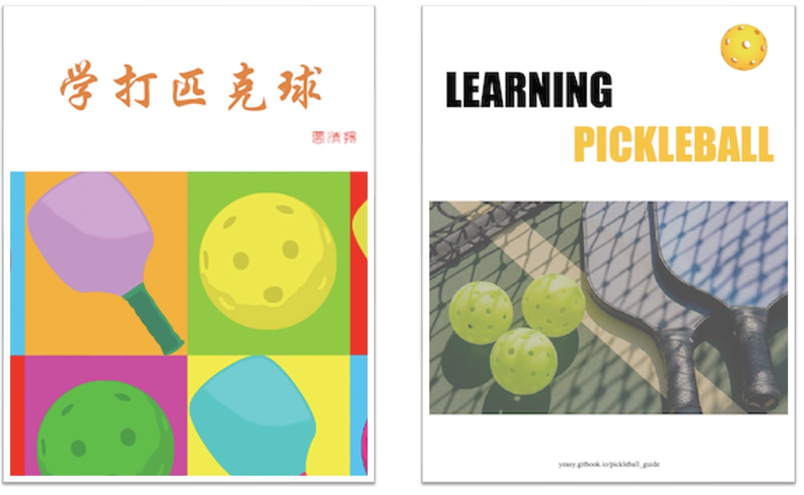
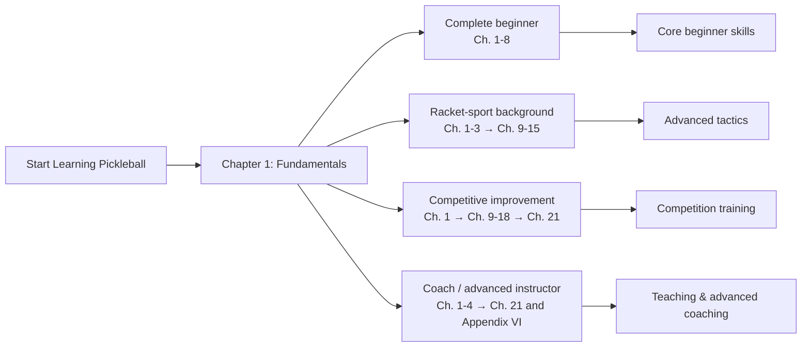

# Learning Pickleball

Learn the rules, practice your first shots, and develop singles and doubles tactics.

**[Read Chapter 1 · Background Knowledge on GitBook](https://yeasy.gitbook.io/learning_pickleball/learning_pickleball_en/01_background)**

[English contents (GitHub)](https://github.com/yeasy/learning_pickleball/blob/main/en/SUMMARY.md) · [PDF editions (GitHub Releases)](https://github.com/yeasy/learning_pickleball/releases/latest) · [中文版](https://yeasy.gitbook.io/learning_pickleball)

## Introduction

**Pickleball** is an emerging sport combining features from tennis, badminton, and table tennis. It's easy to start, moderate in intensity, and highly entertaining. This book systematically introduces techniques from beginner to advanced levels to help you enjoy the sport safely.

## Where to start

- **Before your first game** · Read the [basic rules](https://yeasy.gitbook.io/learning_pickleball/learning_pickleball_en/01_background#id-1.3-basic-rules) to understand scoring, the two-bounce rule, and the non-volley zone.
- **For your first practice** · Start with the [warm-up](https://yeasy.gitbook.io/learning_pickleball/learning_pickleball_en/04_fitness) and [paddle grip](https://yeasy.gitbook.io/learning_pickleball/learning_pickleball_en/03_hold_paddle), then practice [serving and returning](https://yeasy.gitbook.io/learning_pickleball/learning_pickleball_en/05_serve) and [dinking](https://yeasy.gitbook.io/learning_pickleball/learning_pickleball_en/06_dink) with a partner.
- **Once you can sustain a rally** · Read [doubles strategy](https://yeasy.gitbook.io/learning_pickleball/learning_pickleball_en/18_double_strategy) and practice moving up to the net with your partner. For one-on-one play, use the [singles chapter](https://yeasy.gitbook.io/learning_pickleball/learning_pickleball_en/17_single_strategy) to work on serve placement and recovery.

To plan weekly practice, take the self-assessment in [Chapter 2 · Learning Pathways](https://yeasy.gitbook.io/learning_pickleball/learning_pickleball_en/02_learning_pathways) and choose a training plan for your level.

Learning roadmap

Quick references

- [Key tips](https://yeasy.gitbook.io/learning_pickleball/learning_pickleball_en/19_key_tips) · [FAQ](https://yeasy.gitbook.io/learning_pickleball/learning_pickleball_en/20_faq) · [Pickleball terminology](https://yeasy.gitbook.io/learning_pickleball/learning_pickleball_en/appendix_terminologies)

## License & Authorization

This book is authorized for educational use by [numerous clubs and schools](https://github.com/yeasy/learning_pickleball/wiki/).
**Commercial use is prohibited without authorization.**

[License](https://github.com/yeasy/learning_pickleball/blob/main/LICENSE)
